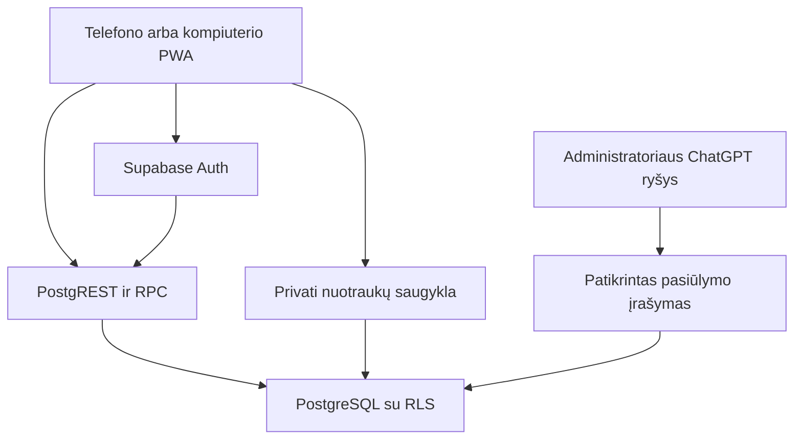
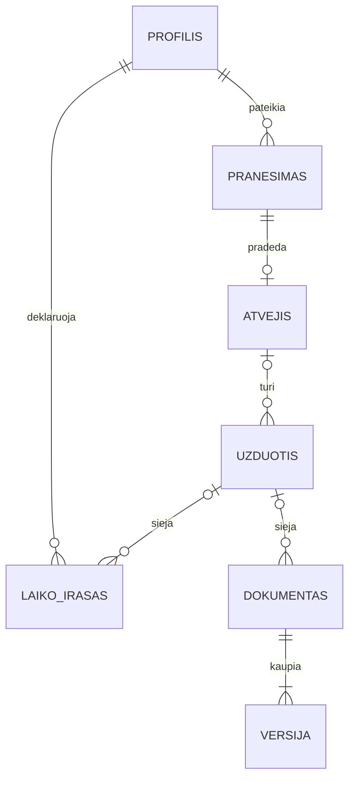

# GI komandos piloto vadovas

2026 m. lapkričio 22 d. leidimas. Prisijungimo paskyros yra tikros. Užduotims, pranešimams, dokumentams ir koordinatėms šiame pilote naudokite demonstracinį turinį. Atsakingo asmens sprendimu realūs GI registrai tebepildomi jų dabartinėse vietose.

[Atidaryti programėlę](https://starlit-shortbread-a38110.netlify.app/pilot/)

## Savanoriui

1. Užpildykite registracijos anketą ir atverkite patvirtinimo laišką. Prisijungus rodoma prieigos būsena. Koordinatorius įvertina anketą.
2. Skiltyje „Mano darbai“ priimkite paskirtą užduotį, paspauskite „Pradėti / tęsti“. Terminas rodomas Vilniaus laiku. Baigę įrašykite konkretų rezultatą ir pateikite peržiūrai.
3. Skiltyje „Mano valandos“ pasirinkite darbo datą, įrašykite valandas ir minutes bei trumpai aprašykite veiklą. Užduotis neprivaloma. Projekto darbams įrašykite projekto pavadinimą. Prie atliktos užduoties galima pridėti papildomą laiką.
4. Skiltyje „Pranešti apie įvykį“ įveskite vietą viena koordinačių pora, įvykio laiką, kategoriją ir aprašą. Iki 10 demonstracinių JPG, PNG arba WebP failų gali būti po 5 MB. Juodraštį galima papildyti. Pateiktą pranešimą peržiūri komanda.
5. Raštų rengimo teisę turintis savanoris skiltyje „Dokumentai“ pasirenka šabloną, susieja užduotį ir pateikia tekstą peržiūrėti. DOCX galima atsisiųsti, PDF išsaugoti per spausdinimo langą.

## Koordinatoriui

Susipažinkite su pranešimu ir jo nuotraukomis. „Pradėti atvejo patikrą“ atidaro vieną atvejį tam pačiam pranešimui. Iš atvejo galima parengti kelias susietas užduotis. Užduoties pasiūlymą paskelbkite fonde ir priskirkite vykdytojui arba rinkitės „Prisiimti sau“. Ieškokite pagal tekstą, būseną, vykdytoją ar terminą. Sąrašo puslapis turi 50 užduočių.

Terminą galima nustatyti kuriant užduotį arba keisti kortelėje iki rezultato pateikimo. Pašalinimas turi atskirą mygtuką. Vienu metu kito žmogaus pakeistą terminą pamatysite atnaujinę kortelę. Asmeniniai pradelstų ir artimiausių septynių dienų darbų priminimai atveria filtruotą sąrašą.

„Patvirtinti rezultatą ir laiką“ vienoje operacijoje patvirtina rezultatą ir visus tam tikrintojui leidžiamus pateiktus tos užduoties įrašus. Ginčytinas eilutes galima pirma grąžinti arba pasirinkti „Patvirtinti tik rezultatą“. Pateikėjo rezultato peržiūrą atlieka kitas žmogus. Laiko suvestinė apima visus savus įrašus, o istorijos sąraše rodomi naujausi 70.

Skiltyje „Pastabos“ vienodo teksto bei kategorijos pranešimai grupuojami automatiškai. Aprašykite vykdytojui tinkamą darbą, susiekite vidinę užduotį ir užrašykite sprendimą. Pirminę pastabą mato jos autorius ir darbuotojai, turintys koordinatoriaus ar administratoriaus teises. GitHub patikros naudoja sintetinius duomenis.

## Prieigos teisės

| Vaidmuo arba atskiras paskyrimas | Užduotys | Laiko tvirtinimas | Dokumentai |
|---|---|---|---|
| Laukiantis el. pašto ar GI patvirtinimo | Prieigos būsena | Nėra | Nėra |
| Kandidatas | Jam leidžiamos demonstracinės užduotys | Deklaruoja savo laiką | Nėra |
| Savanoris, patyręs ar vyriausias savanoris | Savo darbai ir tinkamas fondas | Deklaruoja savo laiką | Savo dokumentai su atskiru leidimu |
| Regiono vadas pagal savanorio laipsnį | Savanorio teisės | Savanorio teisės | Reikalingas atskiras leidimas |
| Koordinatorius arba administratorius | Paskirstymas, atvejai, kito žmogaus rezultato peržiūra | Reikalingas vardinis paskyrimas | Rengimas ir kito žmogaus darbo peržiūra |
| Paskirta darbo laiko koordinatorė | Koordinatoriaus teisės | Savanorių ir kandidatų laikas | Koordinatoriaus teisės |
| Vyriausias administratorius | Administratoriaus teisės | Kitų laikas ir savo bendroji savanorystė | Administratoriaus teisės |

Vyriausias administratorius skiltyje „Komanda“ patikrina koordinatorės tapatybę ir vaidmenį. Patvirtintos organizacijos paskyros kortelėje jis gali pasirinkti „Suteikti valandų tvirtinimo teisę“. Paskyrimai laikomi privačioje lentelėje ir susieti su patikrintu Auth UUID. Keičiantis pareigoms patikrinkite darbo teisę, aktyvų profilį ir pašalintino paskyrimo ID. Prisijungimo forma ir naudotojo redaguojami metaduomenys tokio paskyrimo nesukuria. Savo patvirtinimą žurnalas pažymi atskirai. Projekto ir senesniems neklasifikuotiems įrašams savęs patvirtinimas uždarytas. Finansavimo sutarties vertinimas turi būti atliktas prieš oficialią projekto apskaitą.

## Architektūra ir duomenų modelis





PWA pateikiama per Netlify. GitHub saugo kodą ir migracijas. Apsaugotus įrašus skaito PostgreSQL eilučių prieigos taisyklės. Teises, elgseną kartojant veiksmą ir atominį tvirtinimą vykdo serveris. Service worker saugo statinius PWA failus. Nuotraukų nei API atsakymų jis nekaupia.

Dokumento eiga prasideda juodraščiu. Autorius pateikia versiją peržiūrėti, kitas atsakingas žmogus grąžina ją su pastaba arba patvirtina pasirašymui. Versijos ir pastabos lieka istorijoje. Patvirtinimas pasirašymui yra paskutinė šio leidimo dokumento būsena.

## ChatGPT ir API agentai

Prisijungęs koordinatorius per PostgREST siunčia `POST /rest/v1/rpc/gi_submit_task` su projekto viešu API raktu ir savo galiojančiu naudotojo prieigos žetonu. Siunčiami `p_source_ref`, `p_title`, `p_details`, `p_priority` ir pasirinktinis `p_due` su laiko juosta. Sėkmingas atsakymas yra užduoties UUID. Pakartojimas su tuo pačiu šaltinio kodu išlaiko vieną pasiūlymą.

Administratoriaus prijungtas Supabase MCP gali pateikti vieną struktūrizuotą objektą funkcijai `private.gi_agent_propose(jsonb)`. Šis kelias reikalauja duomenų bazės operatoriaus prieigos. Savanoriams naudojama jų sesija ir autentifikuotas REST kelias. Kiekvienam loginiam darbui išlaikykite pastovų šaltinio kodą.

```json
{"source_ref":"agent:demo/atvejis-01/patikra","title":"Patikrinti bandomąjį pranešimą","details":"Palyginti demonstracinį aprašymą su pridėtais vaizdais.","priority":"normal"}
```

Informacija GI sistemą pasiekia tuo metu, kai prijungtas įrankis iškviečiamas konkrečiame pokalbyje. Operatorius gali skaityti užduoties būseną ir patikrinti `gi_task_events` įrašą. Programėlės RPC `gi_search_tasks_page` teikia matomų užduočių sąrašą, `gi_assign_task` paskiria vykdytoją, `gi_my_time_totals` grąžina savo valandas, `gi_reviewable_logs` patikrina, kurias eilutes gali tvirtinti konkretus naudotojas. Organizacijos mėnesio apskaitai grupuokite minutes pagal darbo datą Vilniaus laiku ir tvirtinimo būseną. Senesnius įrašus be darbo datos rodykite atskirai.

## Patikra ir diegimas

Vykdykite `npm test`. Išsamesnį testą GitHub Actions „Pilot user journeys“ paleidžia kiekvienam aktualiam PR, rankiniu būdu ir pirmadienį 05.17 UTC. Patikra turi skaitymo teisę saugyklai, vietinį Supabase, laiškų gaudyklę ir 20 minučių ribą. Visi paskyrų, GPS bei nuotraukų bandiniai sukuriami izoliuotame projekte. Pakeitimus į pagrindinę šaką sujunkite po šio testo ir Netlify peržiūros. Patikrinkite viešai pateikiamų failų kontrolines sumas.

| Scenarijus | Įrodymas |
|---|---|
| A. Registracija | Vietinis Auth laiškas, nuoroda, nauja sesija, teisės prieš ir po patvirtinimo. |
| B. Paskyrimas | Užduoties sukūrimas, terminas, paskyrimas, priėmimas ir pradžia. |
| C. Rezultatas ir laikas | Po vieno veiksmo duomenų bazėje patvirtintas rezultatas ir 90 minučių. |
| D–F. Tvirtintojai | Vardinis pagrindinis administratorius, draudimas savo projekto laikui, vardinė koordinatorė ir atskira veikla. |
| G. Įvykis | Dešimt privačių vaizdų, vienuolikto atmetimas, peržiūra, vienas atvejis ir susieta užduotis. |
| H. Dokumentas | Versijos, skirtingi rengėjas ir tikrintojas, grąžinimas, patvirtinimas pasirašymui, DOCX ir PDF. |
| I. Agentas | Autentifikuoto REST pakartojimas ir realus administratoriaus MCP pateikimas pilotui grąžino po vieną užduotį. |
| J. Klaidos | Dvigubas spustelėjimas, netinkama data ir el. paštas, nutrūkęs ryšys, draudžiami veiksmai ir imituotas pasenusios sesijos atsakas. |

Naršyklių bandymai naudoja Chromium kompiuterio, Chromium „Pixel“ ir WebKit „iPhone“ profilius. Aparatiniai telefonai, realios savanorių pašto dėžutės, Google OAuth, slaptažodžio atkūrimo laiškas ir tikras elektroninis parašas turi atskirus priėmimo scenarijus.

### Apkrovos bandymas

Izoliuotas testas sugeneravo 20 užduočių vienam vykdytojui. Koordinatoriaus sesija kreipėsi per HTTP, vienu metu vykdant iki 10 filtruotų užklausų. Esant 20 vykdytojų ir 400 užduočių, 95-asis atsako laiko procentilis buvo 79 ms. Esant 100 vykdytojų ir 2 000 užduočių jis buvo 16 ms, o esant 300 vykdytojų ir 6 000 užduočių – 18 ms. Kiekvienas atsakymas turėjo lygiai 20 prašyto vykdytojo darbų. Šie vieno CI paleidimo skaičiai apibūdina filtravimo API. Visos programos su 300 vienu metu prisijungusių telefonų matavimas dar laukia.

[Apkrovos ir naudotojų kelių testas](https://github.com/Giriu-inspekcija/giriu-inspekcija-app/actions/runs/45066507066)

## Tikrieji registrai, atkūrimas ir kiti darbai

| Registras | Dabartinis šaltinis | Kitas žingsnis |
|---|---|---|
| Atvejai | GI Drive „VISI atvejai.xlsx“ | Nustatyti stabilų seno atvejo ID ir prieigos grupę. |
| Darbai | „Darbai ir užduotys“ ir atskira AppSheet prototipo užduočių lentelė | Suderinti vykdytojo, koordinatoriaus ir šaltinio ID. |
| Laikas | Bendras veiklos žurnalas ir atskiras ALF projekto žurnalas | Eksportuoti tiktai patvirtintas eilutes, tikrinti minučių sumą pagal mėnesį, projektą ir žmogų. |
| Oficialūs raštai | „Pagrindinis raštų registras“ ir originalai Drive | Susieti Drive failo ir Gmail pranešimo ID su atsakingo asmens patvirtinimu. |
| GIS | Versijų aplankas ir pažymėta archyvinė sankirtų kopija | Prieš importą su registro tvarkytoju patvirtinti aktualią XLSM redakciją bei teritorijų duomenų versiją. |

Migracijai pirmiausia eksportuoti nekeičiamą kopiją, atlikti tik skaitymo palyginimą ir bandomą importą izoliuotoje aplinkoje. Tikrinti įrašų skaičių, raktų poras, trūkstamas nuorodas, projekto minutes ir prieigų skirtumus. Importo partijai priskirti identifikatorių. Nutraukus pilotą senųjų registrų naudojimas gali tęstis.

Gyvo projekto atsarginės kopijos atkūrimas nebandytas. Prieš realius atvejus patikrinti plano kopijų istoriją, šifruotą atsarginę kopiją atkurti atskiroje aplinkoje ir palyginti įrašų bei failų kontrolines sumas. Supabase duomenų bazės kopija saugo Storage metaduomenis. Atskirai kopijuoti vaizdų turinį. Grąžinant PWA versiją pirmiausia grąžinti Netlify leidimą ir pakeisti podėlio versiją. Produkcinių lentelių trynimas nėra grąžinimo procedūra.

Pirmiausia užbaigti kvalifikuoto parašo įrodymą, autorizuotą Gmail išsiuntimą ir raštų registro įrašą. Lauko darbo plėtrai reikia privataus GPS ir žemėlapio, pranešimų pristatymo bei atvejo sprendimo ir archyvavimo. Vėliau prijungti tikrų registrų sinchronizavimą, sutikrinti mokamo projekto tvirtintojus, gyvų duomenų laikymą ir pasitikrinti poveikį išmatuojant pirmų 20 žmonių darbą.

[Dokumentų užduotis](https://github.com/Giriu-inspekcija/giriu-inspekcija-app/issues/7) · [Lauko darbo užduotis](https://github.com/Giriu-inspekcija/giriu-inspekcija-app/issues/6) · [Atsarginės kopijos](https://supabase.com/docs/guides/platform/backups)

## Mėnesio sąnaudų scenarijai

Skaičiai USD, prieš mokesčius. Pavyzdyje kiekvienam aktyviam naudotojui tenka du papildomi DI teksto apdorojimai po 4 000 įvesties ir 1 000 išvesties žetonų. Taikant GPT-5.4 mini tarifus, vienas kainuotų 0,0075 USD. Piloto įrašymas per MCP arba REST pats nekviečia šio modelio. ChatGPT plano, komandos darbo ir pašto tiekėjo mokesčiai į pavyzdį neįtraukti.

| Aktyvūs žmonės | DI API prielaida per mėnesį | Nuotraukų prieaugis per mėnesį | Dokumentų prieaugis per mėnesį | Jei pakanka nemokamų infrastruktūros planų | Su Supabase Pro nuo 25 USD |
|---:|---:|---:|---:|---:|---:|
| 20 | 0,30 USD | 6 MB | 20 MB | 0,30 USD | 25,30 USD |
| 100 | 1,50 USD | 30 MB | 100 MB | 1,50 USD | 26,50 USD |
| 300 | 4,50 USD | 90 MB | 300 MB | 4,50 USD | 29,50 USD |

Nuotraukų prielaida yra vienas pranešimas dešimčiai naudotojų ir trys 1 MB vaizdai vienam pranešimui. Dokumentams skirta po 1 MB per žmogų per mėnesį esamoje Drive kvotoje. Per metus 300 žmonių pavyzdys sukauptų apie 1,08 GB nuotraukų. Supabase Free apima 1 GB failų ir 500 MB duomenų bazę. Netlify, esamo Drive, siunčiamų laiškų ir GitHub Actions kvotų likučiai turi būti sutikrinti su sąskaitomis. Dabartinis koordinatės įvedimas ir priminimai programėlėje išorinio žemėlapio arba pranešimų siuntimo tarifo neturi.

[Supabase kainos](https://supabase.com/pricing) · [Netlify kainos](https://www.netlify.com/pricing/) · [DI modelio kainos](https://developers.openai.com/api/docs/models/gpt-5.4-mini) · [Užduočių filtrų praktika](https://linear.app/docs/filters) · [Datos lauko semantika](https://developer.mozilla.org/en-US/docs/Web/HTML/Reference/Elements/input/datetime-local)
